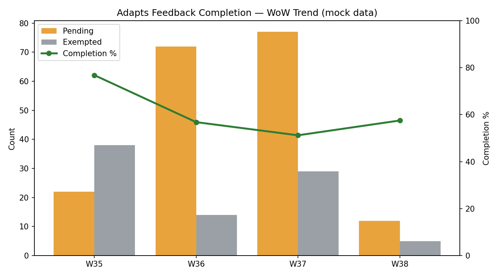
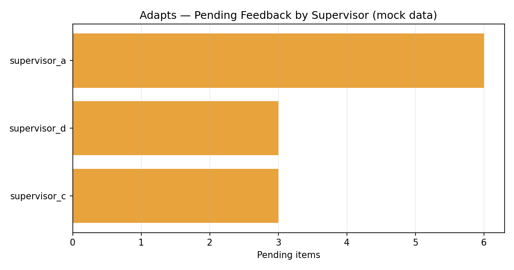

# Adapts Feedback Tracker

Automates weekly tracking of **behavioral-feedback completion** across a site: how many
feedback items are completed vs. pending vs. exempted, who still owes feedback, and how
the completion rate is trending week over week.

> **Sanitized showcase.** The script here runs on **mock data** (`mock_feedback_data.csv`).
> No real associate names, logins, or site data are included.

## The problem

Each week a site generates a list of required behavioral-feedback items (one per flagged
associate), assigned to supervisors to complete. Tracking completion meant manually
filtering a spreadsheet every week, counting by hand, and chasing supervisors — with no
easy way to see whether the site was trending up or down.

## The solution

A small Python tool that ingests the weekly feedback CSV and produces:

1. **Compliance summary** — total / completed / pending / exempted, and completion %.
2. **Per-supervisor pending breakdown** — exactly who still owes feedback, sorted by how
   many are outstanding, so follow-up is targeted.
3. **Trend chart** — completion % as a line with pending/exempted as bars across recent
   weeks, so leadership sees direction at a glance.

## Example output

Week-over-week completion trend (mock data):



Pending feedback by supervisor — the actual follow-up list (mock data):



## Demo

```bash
pip install pandas matplotlib
python adapts_tracker_demo.py
```

This reads [`mock_feedback_data.csv`](mock_feedback_data.csv), prints the weekly summary,
and writes a trend chart to `trend.png`.

Example console output:

```
Week 38 Feedback Compliance — SITE (mock data)
  Total items ....... 40
  Completed ......... 23  (57.5%)
  Pending ........... 12
  Exempted .......... 5

Pending by supervisor:
  supervisor_c ...... 5
  supervisor_a ...... 4
  supervisor_b ...... 3
```

## What I'd highlight

- **Forgiving ingestion.** Headers get trimmed and matched case-insensitively, dates are
  parsed defensively — the tool doesn't break when the weekly export format wobbles.
- **Output maps to action.** The per-supervisor pending list is the actual follow-up
  list; the manager doesn't have to derive it.
- **Trend over snapshot.** A single week's number is noise; the week-over-week line is
  what tells you whether an intervention worked.

## Tech stack

`Python` · `pandas` · `matplotlib`

## Files

| File | Purpose |
|---|---|
| `adapts_tracker_demo.py` | Runnable demo: summarize + chart, on mock data |
| `mock_feedback_data.csv` | Synthetic weekly feedback data (no PII) |
