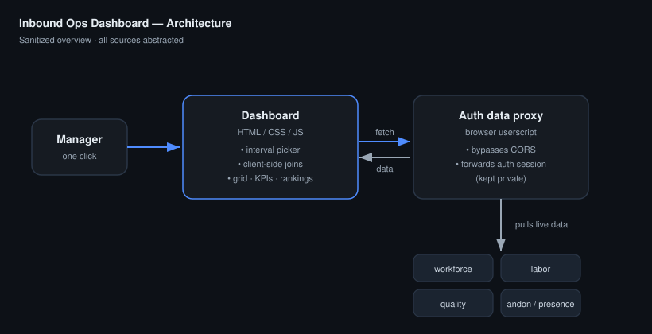

# Inbound Ops Dashboard

A single-page, live operations dashboard that pulls inbound/stow performance into **one
view** — productivity, quality, and coaching — so an Area Manager can see the whole floor
at a glance instead of flipping between a half-dozen reporting systems.

> **Sanitized showcase.** This folder documents the design and engineering approach. The
> live dashboard HTML, the authenticated data-proxy userscript, and all internal
> endpoints are **not** included (they carry internal URLs, auth logic, and facility
> data). See the repo-level [`docs/SANITIZATION.md`](../../docs/SANITIZATION.md).

## Interactive demo

A fully interactive, **synthetic-data** version of the dashboard lives in
[`demo/index.html`](demo/index.html) — open it in any browser (no login, no network, no
real data). Pick an interval, filter by floor/side, click **Run Stow**, and sort the
associate table. It reproduces the real layout: KPI cards, floor grid, mix-weighted
Top/Bottom performer columns, quality-by-floor, and a sortable all-associates table —
entirely on fake data generated in-page.

> The live internal dashboard can't be auto-rendered in this public repo. To add a static
> preview image to this README, open the demo and take a screenshot. The two Python
> projects include real mock-data charts under [`docs/screenshots/`](../../docs/screenshots/).

## The problem

Inbound performance data was scattered across several internal systems, each with its own
login, its own export format, and its own key for identifying an associate (employee ID in
one, login/alias in another, station in a third). To answer a simple question —
*"who's behind this interval and why?"* — a manager had to open several tools, export CSVs,
and reconcile them by hand. By the time that was done, the interval was over.

## The solution

One HTML dashboard that:

- Lets the user pick a **date + shift interval** (hour/quarter-hour granularity).
- Pulls live data from the underlying systems client-side and **joins it on the fly**.
- Renders a floor view (station grid), KPI cards, and ranked performer tables — updating
  in a single click.

### Tabs / sections

| Section | What it shows |
|---|---|
| **Floor grid** | A 2×2 area grid (by side: East / North / West / South) with per-station throughput, mix, and headcount. |
| **KPI cards** | Interval KPIs mirrored from the throughput plan (rate, % to plan, etc.). |
| **Top / Bottom performers** | Side-by-side ranked tables of the strongest and weakest performers for the interval, each independently scrollable, with a shared floor/side filter. |
| **All associates** | A searchable, sortable table of every associate in the interval. |
| **Quality** | Quality KPIs by floor (defect-rate style metrics). |
| **Guided coaching** | Associates with open coaching, surfaced next to their performance. |

## Architecture



```
┌──────────────────────────┐      ┌───────────────────────────┐
│  Dashboard (HTML/CSS/JS)  │      │  Authenticated data proxy  │
│  - interval picker        │◄────►│  (browser userscript)      │
│  - client-side joins      │ fetch│  - bypasses CORS           │
│  - render grid/KPIs/tables│ calls│  - forwards auth session   │
└──────────────────────────┘      └─────────────┬─────────────┘
            ▲                                     │ pulls live data from
            │                                     ▼
       the manager                 workforce reporting · labor tracking ·
       (one click)                 quality system · andon/presence · ...
```

### The interesting engineering problems

1. **Identity reconciliation.** The same associate appears as a 9-digit employee ID in
   the labor system, a login/alias in the presence system, and a station in the floor
   system. The dashboard resolves all three via a profile lookup so one person's data
   lines up across every source.

2. **Mix-weighted ranking.** Associates stow a mix of item sizes with different rate
   expectations. A naive "units per hour" ranking punishes whoever got the harder mix.
   The ranking instead computes a **blended target** from each associate's actual size
   mix, then ranks by *percent-of-target* — so "making rate" is fair regardless of mix.
   See [`docs/RANKING.md`](docs/RANKING.md).

3. **Rate-limit-aware fetching.** Some detail reports are large (hundreds of KB of HTML
   per associate) and the backend times out under load. The dashboard batches these
   fetches (small concurrency, never long sequential loops) to stay within limits while
   still populating quickly.

4. **Resilient rendering.** Partial/missing data for an interval must degrade gracefully
   (show `N/A`, not a blank page). Learned the hard way that one stale reference in a
   logging line can abort an entire render — so field renames are kept in sync everywhere,
   and state reads are guarded.

## Metrics tracked

- Throughput rate & % to plan (per interval, per station, per side)
- Item-size mix
- Turnaround / rework signals
- "Out of work" andon counts per associate
- Idle time / time-off-task percentage
- Quality defect rates by floor
- Open guided-coaching status

## Tech stack

`HTML` · `CSS` · `vanilla JavaScript` · `client-side data joins` · `userscript data proxy`
(kept private) · internal reporting APIs (abstracted)

## What I'd highlight

This started as a read-only copy of a colleague's dashboard and grew into a co-developed
tool — I built the stow productivity and quality sections and merged them back into the
shared version. It's a good example of **shipping a real tool inside operational
constraints**: no backend to deploy to, auth I don't control, rate limits I can't change —
and still landing a one-click daily-driver that other managers use.
