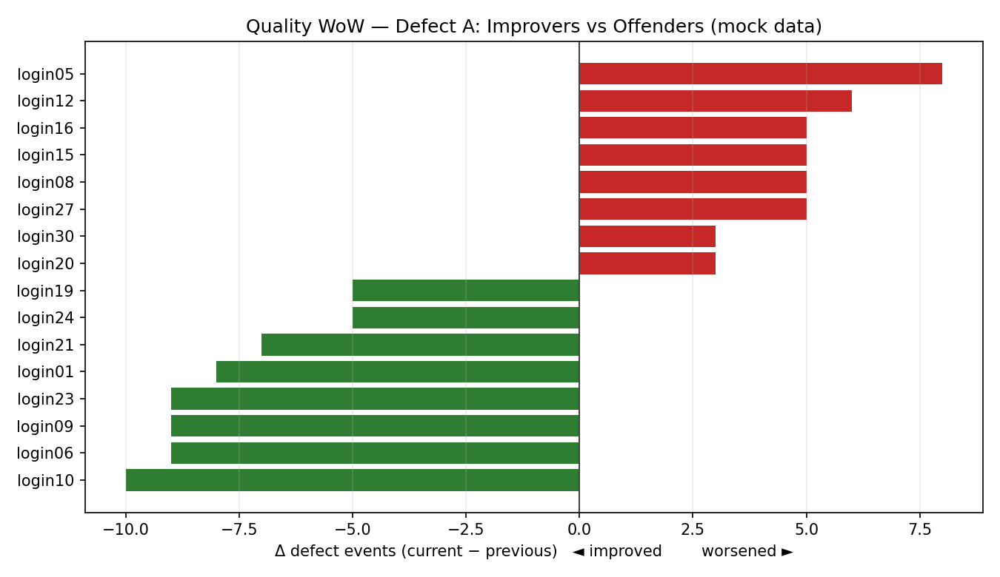

# Quality WoW Tracker

Compares associate **quality metrics week-over-week** and automatically produces ranked,
shareable Excel reports — the biggest improvers and the biggest offenders — across several
defect metrics at once.

> **Sanitized showcase.** The demo runs on **mock data** (`mock_week_prev.csv` /
> `mock_week_curr.csv`). No real associate data is included.

## The problem

Quality coaching needs to be targeted: you can't coach everyone, so you focus on the
people who regressed the most and recognize the people who improved the most. Doing that
by hand meant exporting two weeks of data, aligning associates across both, computing the
delta per metric, sorting, and formatting — repeated for every metric, every week.

## The solution

A Python tool that takes **last week's** and **this week's** quality export and, for each
tracked metric, generates an Excel report ranking associates by week-over-week change:

| Metric | Direction | Lead report |
|---|---|---|
| Defect-event rate (type A) | fewer = better | Top improvers |
| Drop-to-exception rate | more = worse | Top offenders |
| Quantity-defect events | fewer = better | Top improvers |
| Bin/placement violations | fewer = better | Top improvers |

Reports are written into a tidy per-week folder structure:

```
reports/
└── weekly/
    └── Week NN/
        ├── Week NN <metric A> report.xlsx
        ├── Week NN <metric B> report.xlsx
        └── ...
```

## Example output

Week-over-week change for one metric — biggest improvers (green) vs offenders (red), on
mock data:



## Demo

```bash
pip install pandas numpy openpyxl
python quality_wow_demo.py
```

This reads the two mock CSVs, computes the week-over-week comparison for each metric, and
writes `reports/weekly/Week 38/…xlsx`. It also prints a quick console preview of the top
improvers and offenders.

## What I'd highlight

- **Multi-metric, config-driven.** Metrics are declared in one dictionary
  (`column → label → improver/offender mode`); adding a metric is one line, not a new
  code path.
- **Forgiving ingestion.** Case-insensitive, whitespace-tolerant header matching means the
  tool survives small changes in the export format.
- **Self-organizing output.** The week number is parsed from the filename and used to
  build the folder tree automatically, so a season of weekly runs stays organized without
  manual filing.

## Tech stack

`Python` · `pandas` / `numpy` · `openpyxl` (styled Excel output)

## Files

| File | Purpose |
|---|---|
| `quality_wow_demo.py` | Runnable demo: WoW comparison + Excel reports, on mock data |
| `mock_week_prev.csv` | Synthetic "previous week" quality data |
| `mock_week_curr.csv` | Synthetic "current week" quality data |
